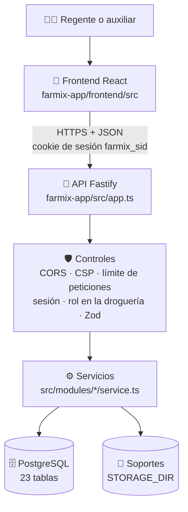

# 01 · Arquitectura

## Qué es
La **arquitectura** es el plano de la aplicación: qué piezas tiene y cómo se comunican.
FARMIX usa una arquitectura **cliente-servidor en capas**, la misma idea del restaurante:

| Capa | Analogía | En FARMIX | Carpeta de esta guía |
|---|---|---|---|
| 📱 Frontend (cliente) | El salón y el menú | React en el navegador | `02-frontend` |
| 🔗 API | El mesero | Rutas HTTP `/api/v1/...` que hablan en JSON | `03-backend` |
| ⚙️ Servicios | La cocina | Reglas de negocio en `src/modules/*/service.ts` | `03-backend` |
| 🗄️ Datos | La despensa (el kárdex) | PostgreSQL 16, más los archivos de soporte en disco | `04-base-de-datos` |

## Stack (tecnologías reales)
| Parte | Tecnología |
|---|---|
| Frontend | React 19, TypeScript, Vite, React Router, PWA instalable (rama `pwa-instalable`) |
| Backend | Node.js 22, TypeScript estricto, Fastify 5, Zod 4, Drizzle ORM |
| Base de datos | PostgreSQL 16 |
| Seguridad | Argon2id (contraseñas), cookie `httpOnly`, helmet/CSP, límite de peticiones |
| Pruebas | Vitest (391 pruebas) y Playwright (recorrido de 22 pasos) |
| Despliegue | Docker y Render (un solo servicio sirve la web y la API) |

Las versiones exactas y la justificación de cada librería están en [`farmix-app/docs/04-stack.md`](../../farmix-app/docs/04-stack.md).

## Recorrido de un clic: registrar un residuo
| # | Qué pasa | Archivo real |
|---|---|---|
| 1 | La persona llena el formulario y pulsa Guardar | `frontend/src/pages/WastePage.tsx` |
| 2 | El frontend envía `POST /api/v1/drugstores/:id/waste-records` con JSON | `frontend/src/api.ts` |
| 3 | Fastify asigna un `X-Request-Id`, aplica CORS, cabeceras de seguridad y límite de peticiones | `src/app.ts` |
| 4 | **Vigilante de la puerta:** ¿hay sesión válida? ¿la persona es miembro de esa droguería con rol suficiente? | `src/modules/auth/plugin.ts`, `src/modules/drugstores/guard.ts` |
| 5 | **Regente que revisa la fórmula:** Zod valida cada campo | `src/modules/waste/schema.ts` |
| 6 | Reglas de negocio (medicamento vencido ≠ riesgo biológico, fecha no futura) y guardado | `src/modules/waste/service.ts` |
| 7 | PostgreSQL aplica sus propias reglas (`CHECK`, claves foráneas): **último filtro** | migración `0005_waste.sql` |
| 8 | Se registra la auditoría | `src/shared/audit.ts` |
| 9 | Respuesta `201` con el residuo, o un error con el formato único `{ error: { code, message, requestId } }` | `src/shared/error-handler.ts` |

Si falta la sesión responde `401`; si la droguería no es suya, `404` (para no revelar que existe); si el rol no alcanza, `403`; y si los datos son inválidos, `400`.

## Decisiones de diseño que debe poder defender
1. **Tres filtros de validación** (frontend, Zod y base de datos): el usuario recibe mensajes claros y los datos quedan protegidos aunque falle una capa.
2. **Aislamiento por droguería** en el código (`guard.ts`) **y** en la base de datos (claves foráneas compuestas `(drugstore_id, id)`).
3. **Estados calculados al consultar** (vencido, vigente, porcentaje de segregación): nunca se guardan, así no pueden quedar desactualizados.
4. **Un solo servicio** sirve la web y la API: sin problemas de CORS y con la cookie en el mismo origen.

Documento técnico completo: [`farmix-app/docs/03-modelo-arquitectonico.md`](../../farmix-app/docs/03-modelo-arquitectonico.md).

## Autoevaluación
1. ¿Por qué un usuario de otra droguería recibe `404` y no `403`?
2. Si se borrara la validación de Zod, ¿qué capa seguiría impidiendo un peso negativo?
3. ¿Qué ventaja tiene que el porcentaje de segregación se calcule al consultar y no se guarde?
