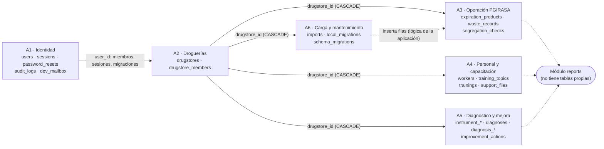

# Modelo estructural de datos de FARMIX

Vista de alto nivel: las 23 tablas agrupadas en 6 áreas funcionales, sin entrar en columnas.
Las áreas se comprobaron contra el código: cada tabla se asignó según los módulos que la usan (`src/modules/*`).

## Áreas funcionales

| Área | Qué representa | Necesidad que resuelve | Tablas | Módulos que la usan |
|---|---|---|---|---|
| **A1. Identidad, sesiones y auditoría** | Quién usa FARMIX y qué rastro deja | Acceso seguro y trazabilidad (en el prototipo v1 las cuentas vivían en el navegador) | `users`, `sessions`, `password_resets`, `audit_logs`, `dev_mailbox` | auth, users, personal-data, audit |
| **A2. Droguerías y acceso por roles** | Droguerías y quién trabaja en cada una | Aislar los datos de cada droguería y compartirla con roles | `drugstores`, `drugstore_members` | drugstores (`guard.ts` decide los permisos) |
| **A3. Operación PGIRASA** | Vencimientos, residuos y verificaciones de segregación | Las funciones esenciales del MVP y su indicador de evaluación | `expiration_products`, `waste_records`, `segregation_checks` | expirations, waste, segregation, imports, reports |
| **A4. Personal, capacitación y soportes** | Trabajadores, temas, capacitaciones y archivos | Evidenciar la capacitación vigente con soporte documental | `workers`, `training_topics`, `trainings`, `support_files` | staff, files, reports |
| **A5. Diagnóstico y plan de mejora** | Instrumento versionado, diagnósticos, respuestas, puntajes y acciones | Medir el cumplimiento y hacer seguimiento a los incumplimientos | `instrument_versions`, `instrument_items`, `diagnoses`, `diagnosis_answers`, `diagnosis_area_scores`, `improvement_actions` | diagnoses, actions, reports |
| **A6. Carga de datos y mantenimiento** | Importaciones, migración local y versiones del esquema | Pasar datos desde Excel o CSV y cambiar la estructura de forma ordenada | `imports`, `local_migrations`, `schema_migrations` | imports, local-migrations, `db/migrate.ts` |

## Diagrama de alto nivel

**Cómo leerlo:**
- **Líneas continuas:** claves foráneas declaradas en PostgreSQL (hechos).
- **Líneas punteadas:** relaciones que existen solo en el código (`imports` crea filas en A3; `reports` lee A3, A4 y A5 a través de sus servicios).
- No se dibujan las 30 claves foráneas de auditoría (`created_by` y `updated_by` → `users`), que están en casi todas las tablas, porque taparían la estructura. Sí aparecen en `relaciones.csv` y en `modelo-logico-completo.mmd`.

## La idea central: `drugstores` es el eje

Doce tablas tienen la columna `drugstore_id`, con `ON DELETE CASCADE`. Esto quiere decir que **todo dato de negocio pertenece a una droguería** y que, si una droguería se elimina físicamente, se elimina con todo su contenido.
En la práctica la aplicación usa el **borrado lógico** (`deleted_at`), así que esa cascada funciona como red de seguridad, no como operación habitual (por verificar en la Etapa 2).

## Equivalencia con el prototipo v1 (`prototipo-v1/index.html`)

| Prototipo v1 (JSON en el navegador) | Versión actual (tablas) | Observación |
|---|---|---|
| `farmix_users` (cuentas y sesiones) | `users`, `sessions` | En v1, hash con sal en el navegador; en v2, Argon2id en el servidor |
| `droguerias[].establecimiento` | `drugstores` | v2 agrega `drugstore_members` (varios usuarios por droguería) |
| `vencimientos` (producto, lote, fecha, cantidad, costo, destino) | `expiration_products` | El costo permite calcular pérdidas en ambas versiones |
| `residuos` (fecha, tipo, clasificación, cantidad, unidad, manejo) | `waste_records` | v2 añade reglas `CHECK` sobre la clasificación |
| `personal`, `capacitaciones` (con `temaId`) | `workers`, `trainings`, `training_topics` | |
| `diagnosticos`, `acciones` | `diagnoses`, `diagnosis_answers`, `diagnosis_area_scores`, `improvement_actions` | v2 versiona el instrumento (`instrument_versions`, `instrument_items`) |
| soportes en IndexedDB | `support_files` | |
| *(no existe)* | `segregation_checks` | El indicador de segregación nace en v2 |
| *(no existe)* | `imports`, `local_migrations`, `audit_logs` | |
