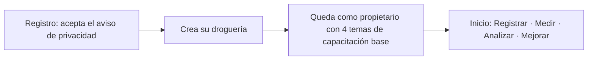
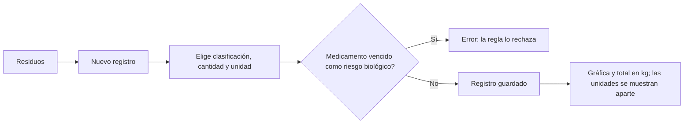
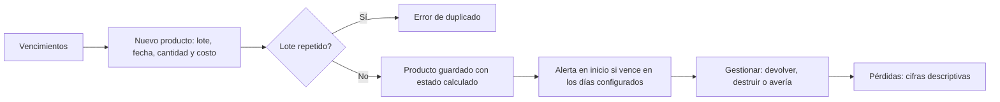
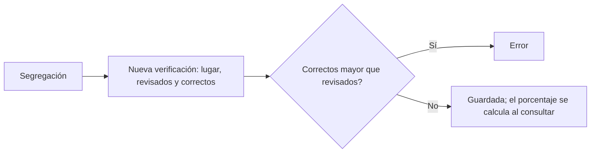
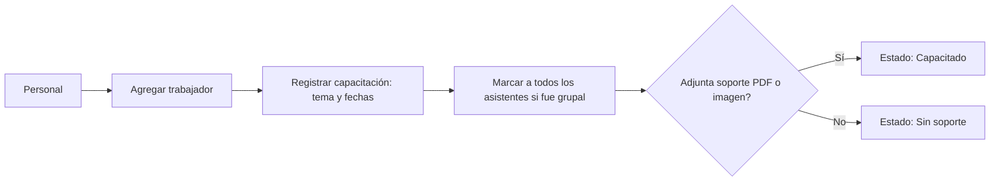
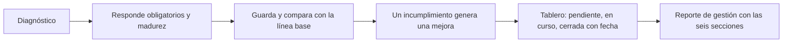

# Flujos de usuario y capturas del sistema (Fase 2 · diseño)

La propuesta (Fase 2) pide «flujos de usuario, wireframes y prototipo visual». Esta carpeta aporta **capturas del sistema ya construido** (no son wireframes previos al desarrollo) y los flujos reconstruidos desde las rutas y el recorrido de pruebas.
**Wireframes:** ver [`wireframes/`](wireframes) (17 pantallas, reconstruidas).
**Honestidad sobre el origen:** los wireframes originales no existen en el repositorio; estas capturas documentan el **resultado**. Si la universidad exige wireframes previos, habría que dibujarlos aparte.
Todas las capturas usan **datos simulados** (droguería «de demostración», marcada en pantalla) en una base local desechable; no hay datos reales ni producción. Las cifras que se ven (p. ej. 84,1 % de segregación) son de ejemplo.

## Capturas (carpeta [`capturas/`](capturas))
| Archivo | Ruta | Qué muestra | Req. |
|---|---|---|---|
| `01-login` | `/login` | Ingreso | R6 |
| `02-registro` | `/registro` | Alta de cuenta con aceptación del aviso de privacidad | R6, R12 |
| `03-recuperar` | `/recuperar` | Recuperación de contraseña | R6 |
| `04-droguerias` | `/` | Lista de droguerías de la cuenta | R7 |
| `05-inicio` | `/d/:id` | Ciclo Registrar · Medir · Analizar · Mejorar, alertas e indicadores | R2, R5 |
| `06-vencimientos` | `/d/:id/vencimientos` | Productos por vencer, estado y pérdidas | R2, R3 |
| `07-residuos` | `/d/:id/residuos` | Registro de residuos por clasificación | R1 |
| `08-segregacion` | `/d/:id/segregacion` | Verificaciones de segregación | R5 |
| `09-personal` | `/d/:id/personal` | Trabajadores y capacitaciones | Propuesta F2 |
| `10-diagnostico` | `/d/:id/diagnostico` | Diagnóstico (obligatorios y madurez) | O1 |
| `11-plan-de-mejora` | `/d/:id/diagnostico?v=mejoras` | Tablero de mejoras | O1b |
| `12-reporte` | `/d/:id/reporte` | Reporte de gestión | R4 |
| `13-normativa` | `/d/:id/normativa` | Marco legal | O1 |
| `14-importar` | `/d/:id/importar` | Importar Excel/CSV con vista previa | X2 |
| `15-migrar` | `/d/:id/migrar` | Migrar datos locales | X3 |
| `16-miembros` | `/d/:id/miembros` | Miembros y roles | R8 |
| `17-configuracion` | `/d/:id/configuracion` | Datos y días de alerta | R7 |
| `18-cuenta` | `/cuenta` | Privacidad, descarga y borrado de datos | R12 |
| `m1-inicio`, `m2-vencimientos`, `m3-residuos` | móvil 390 px | Vista en teléfono (menú lateral plegado) | Usabilidad |

## Flujos de usuario
(Reconstruidos de `App.tsx`, `rutas.md` y los pasos del recorrido en navegador. Se ven como diagrama en GitHub, VS Code o Mermaid Live.)

### Flujo 1 · Primer uso

### Flujo 2 · Registrar un residuo (R1)

### Flujo 3 · Vencimientos y alertas (R2, R3)

### Flujo 4 · Segregación (R5)

### Flujo 5 · Capacitación del personal

### Flujo 6 · Medir y mejorar (O1, O1b, R4)

## Cómo se obtuvieron (repetible)
Servidor en modo producción local contra una base **nueva** (`farmix_capturas`), datos con `npm run seed:demo`, y un script de Playwright que inicia sesión y recorre las rutas a 1280×860 (y tres a 390×844). El script no se guardó en el repositorio; puedo agregarlo como `05-pruebas/scripts/capturas.sh` si lo quieres.

## Límites
- Capturas de **pantalla completa** tal como estaban al generarlas (rama `modelo-datos`, sin la PWA).
- No capturé estados de error ni ventanas emergentes (formularios abiertos); solo las pantallas principales.
- Revisé a ojo dos capturas (`05-inicio` y `m1-inicio`); las demás se generaron con el mismo script, pero **no las inspeccioné una por una**.
